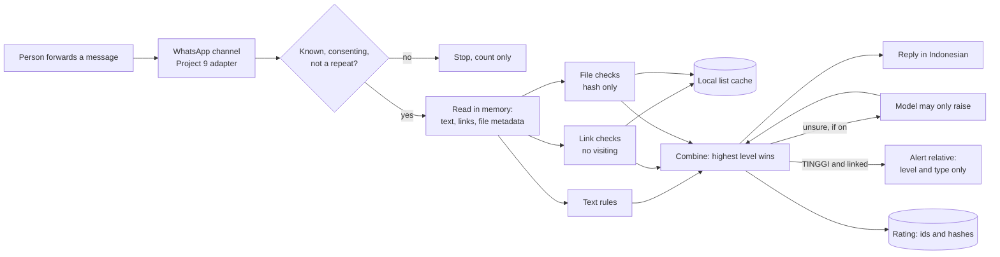

# Phase 2: Requirements & Constraints

Phases 3 (threats) and 4 (design) are folded in, as in Project 9. Threats
have their own page: [threat model](threat-model.md). The build goes in
slices ([slice plan](slice-plan.md)).

## Core scenario

1. **Joining.** Arthur adds a person's number (allow-list, as in Project
   9). They message the guard. It replies with a short notice in
   Indonesian: what it does, that it never says "safe", what it keeps
   (nothing of the message), that it runs on an unofficial WhatsApp client that
   can be banned (so no reply means call the bank directly), and that it
   never contacts anyone first except a relative they link. They type
   `setuju`.
2. **Checking a message.** They forward "Paket Anda tertahan, lihat foto
   paket" with an APK.
   1. The channel checks the webhook and drops repeats (Project 9's code).
   2. The text, links and attachment metadata are read in memory.
   3. Rules and lists rate it. An APK from a chat is **TINGGI** on its own.
   4. The guard replies: "**Risiko TINGGI.** Ini mirip penipuan APK kurir.
      Jangan pasang aplikasinya. Hapus pesannya. Kalau sudah terpasang:
      matikan data, hubungi bank lewat nomor di kartu, dan lapor ke IASC
      (iasc.ojk.go.id)."
   5. If they have a linked relative, the relative gets an alert (step 4).
   6. Nothing about the message is stored except its rating, rule ids and
      hashes (ADR-008).
3. **When it can't check.** A shortened link, an unknown file, or a list
   that is down: **TINGGI**, saying why ("kami tidak bisa memeriksa tautan
   ini"). Unknown is never rated low.
4. **Family alert.** The relative gets: "Ibu Sari baru menerima pesan
   **berisiko tinggi** (APK kurir). Mungkin perlu ditelepon." Never the
   message, its links or its sender. The protected person is told the alert
   went.
5. **Linking.** The protected person types `tambah keluarga 08xx`. The
   relative must also agree (`setuju jaga`). Either can end it with
   `berhenti`.
6. **Leaving.** `hapus data saya` removes the person, their links and
   their ratings.

## Requirements

**Verdicts (ADR-004)**
- **V1.** Three levels only: `TINGGI`, `SEDANG`, `RENDAH`. No "aman",
  "safe", "terpercaya" or a tick as a verdict, checked by a test over
  every reply template.
- **V2.** Every reply says what to do next, and every `TINGGI` reply
  names the bank's official number route and IASC.
- **V3.** Every reply ends with one line: it is not a guarantee.
- **V4.** Unknown links, unknown files, shorteners and list failures are
  `TINGGI`, with the reason given.
- **V5.** Any APK, or a file whose name or type says APK, is `TINGGI`
  regardless of lists.
- **V6.** `RENDAH` requires every link to be on the allow-list of known
  domains (ADR-006) and no rule to fire.

**Checks (ADR-005, ADR-006)**
- **K1.** Text rules in a versioned YAML file, matched after Unicode
  normalisation (the gateway's `RulesDetector` approach).
- **K2.** Link checks without visiting: lookalike brand domains, punycode,
  raw IPs, shorteners, free-hosting subdomains, then the lists.
- **K3.** File checks without opening: name, declared type, size, and the
  SHA-256 of the bytes, looked up in MalwareBazaar.
- **K4.** No code path visits a link, follows a redirect, opens, unpacks,
  renders or runs an attachment.
- **K5.** Lists are fetched by a scheduled job into a local cache. A
  message is checked against the cache, so a user's link isn't sent to a
  third party, except Safe Browsing's hash-prefix check (ADR-006).
- **K6.** A rating names the rule ids and list hits that caused it, kept
  as ids only.

**Screenshots and voice notes (later slices)**
- **S1.** A screenshot is read by OCR in memory, then checked as text.
  The image is never stored.
- **S2.** A voice note: only if its slice is approved (ADR-013).

**Family alert (ADR-009)**
- **F1.** A link needs both sides to agree, and either can end it.
- **F2.** An alert carries the level and scam type only.
- **F3.** At most `MAX_ALERTS_PER_DAY` (3) per protected person, then one
  daily summary, so a flood of scams can't flood the relative.
- **F4.** The protected person is told each time an alert is sent, and
  can list and remove links.

**Identity, consent and leaving (reused from Project 9)**
- **I1.** Identity only from the signed webhook. Unknown senders get no
  reply and leave only a count.
- **I2.** Nothing is kept before `setuju`, and the notice version is
  recorded.
- **I3.** `hapus data saya` deletes every row for that person.
- **I4.** Row-level security between people.

**Privacy (ADR-008)**
- **PR1.** No message text, image, audio or file is stored by default.
- **PR2.** Logs and spans hold no content, numbers or names (Project 9's
  tests).
- **PR3.** A message that looks like it carries the person's own OTP, PIN
  or card number gets a warning not to share it, and nothing is stored.
- **PR4.** Ratings keep: person, time, level, scam type, rule ids, URL
  hashes and file hashes. Kept 90 days, then purged.
- **PR5.** Donating a message to the labelled set is a separate, explicit
  step, redacted first (measurement plan).

**Measurement (measurement plan)**
- **E1.** The scorer runs on the public set in CI and on the real set
  locally. Held-out is scored once per rules version.
- **E2.** A test fails if a rules change lowers any rating on the public
  set's scam rows without a written reason.

**Reliability**
- **R1.** Startup refuses to run without the webhook secret.
- **R2.** A list fetch failure leaves the old cache in place and alerts.
  A cache older than `MAX_LIST_AGE_HOURS` (48) makes link checks fail
  closed (`TINGGI`, "can't check").
- **R3.** `/healthz` reports the list ages.

## Design (Phase 4, folded)

**The combining rule:** each check returns a level and its reasons. The
final level is the highest. Nothing can lower a level another check set.

**Tables:** `person`, `inbound_message` (id only), `family_link` (both
consents and times), `rating` (level, type, rule ids, hashes),
`alert` (unique per rating), `list_snapshot` (source, fetched at, count).

## Constraints

- **Channel:** WAHA, settled (ADR-002). A spare SIM for slices 3 and 4.
- **Money:** $0 for rules and lists. A model needs an approved budget.
  WhatsApp bills nothing on WAHA; the risk is a ban (ADR-012).
- **Capacity:** the same small shared server. No OCR or speech model on it
  until measured (ADR-013).
- **Order:** after Project 9's deploy, because the channel comes from it.
- **Public repo:** no real messages, numbers or server addresses. The real
  set stays in `data/real/`.

## Priorities

| | Items |
|---|---|
| **Must** | V1–V6, K1–K6, F1–F4, I1–I4, PR1–PR5, E1–E2, R1–R3 |
| **Should** | S1 (screenshots) |
| **Could** | S2 (voice notes), the model fallback |
| **Won't (v1)** | Everything under Non-goals in Phase 1 |
